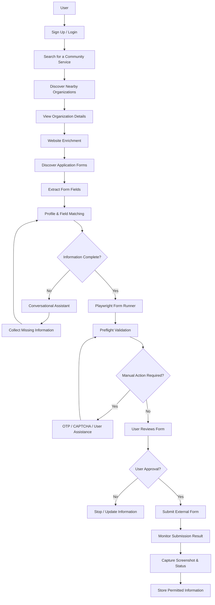

# One Degree – AI-Powered Resource Navigator & Intake Assistant

  <strong>Discover nearby community services. Understand application forms. Simplify the enrollment process.</strong>

  
  
  
  
  

---

## 📌 Project Overview

Finding nearby community services such as healthcare facilities, food banks, schools, and government offices can be challenging. Even after finding a suitable organization, completing its application or booking process can involve navigating websites, locating forms, entering personal details, and handling additional verification steps.

The **One Degree POC** explores an AI-assisted approach to simplifying this journey.

Inspired by two key concepts:

- **AI Resource Navigator:** Helps users discover relevant community services nearby.
- **AI Intake & Enrollment:** Helps users understand application forms, match existing profile information, and complete forms with appropriate human approval.

The POC demonstrates an end-to-end workflow that connects service discovery with assisted form completion.

> **Note:** This is an independently developed proof of concept inspired by the above concepts. It does not copy the original One Degree website or its data. It uses public map data and information available on organizations' own public websites.

---

## 🎯 Project Objectives

The main objective is to demonstrate how users can move from finding a service to completing its application process through a guided experience.

1. Search for a required community service.
2. Discover nearby organizations using map data.
3. View organization details and public information.
4. Discover application and appointment forms on organization websites.
5. Extract and understand form fields and questions.
6. Match form questions with previously available user profile information.
7. Ask users only for missing or unconfirmed information.
8. Automatically fill supported form fields.
9. Validate responses against the form's requirements.
10. Support human intervention for OTP, CAPTCHA, and other manual steps.
11. Allow users to review and approve information before submission.
12. Capture the submission outcome as evidence.

---

## ✨ Key Features

### 1. Community Resource Discovery
- Search for services using keywords or predefined categories.
- Discover nearby organizations using OpenStreetMap data.
- Display search results on an interactive map.
- View organization information and available contact details.

### 2. Website Enrichment & Form Discovery
- Retrieve additional public information from organization websites.
- Identify appointment and application-related pages.
- Crawl supported websites to discover available forms.
- Store discovered website and form metadata for reuse.

### 3. Intelligent Form Understanding
- Extract form fields, labels, input types, required fields, options, and validation patterns.
- Understand questions even when different websites use different wording.
- Identify relationships between form questions and existing user information.

### 4. Profile Matching
- Match extracted form fields against previously available profile information.
- Reuse eligible information where appropriate.
- Identify missing or uncertain values.
- Ask users for only the information that is still required.

### 5. Automated Form Filling
- Use Playwright to interact with supported external forms.
- Populate fields using the collected and confirmed information.
- Handle dropdowns and dependent form fields.
- Validate responses before attempting submission.

### 6. Human-in-the-Loop Assistance
- Request OTP verification from the user when required.
- Allow users to complete CAPTCHA challenges.
- Support manual intervention for file uploads and other actions that require user participation.
- Require user approval before final submission.

### 7. Submission Monitoring & Evidence
- Monitor the external website after submission.
- Identify success messages, validation errors, and uncertain outcomes.
- Capture screenshots of the observed result.
- Report the outcome without claiming success unless supported by evidence.

---

## 🔄 End-to-End Workflow

---

## 🛠️ Technology Stack

| Layer | Technologies | Purpose |
|---|---|---|
| Frontend | HTML, CSS, JavaScript | User interface and interactive pages |
| Backend | Python, FastAPI | API development and application logic |
| Database | PostgreSQL | User profiles, resource information, form metadata, and request tracking |
| Authentication | JWT, bcrypt | Token-based authentication and password hashing |
| Browser Automation | Playwright | Website interaction and automated form filling |
| Web Scraping | BeautifulSoup, httpx | Website content retrieval and parsing |
| Map & Location | OpenStreetMap, Overpass API, Nominatim, Photon | Location search and nearby resource discovery |
| Map Visualization | Leaflet | Interactive maps |
| AI & NLP | Rule-based NLP, Hugging Face LLM | Form understanding and intelligent field matching |
| NLP Techniques | Regular Expressions, Lemmatization, TF-IDF, Fuzzy Matching | Text processing and question matching |
| Server | Uvicorn | Running the FastAPI application |

**Additional integrations:** DuckDuckGo search and optional services such as Serper, SerpAPI, HERE, TomTom, and Foursquare for web search and location enrichment. Availability depends on the configured service and its usage limits.

---

## 🧠 AI & NLP Approach

The POC combines rule-based NLP techniques with an optional Hugging Face language model.

| Technique | Application |
|---|---|
| Regular Expressions | Identify patterns and extract structured information |
| Lemmatization | Normalize words for comparison |
| TF-IDF Keyword Scoring | Identify relevant terms and similarities |
| Fuzzy Matching | Match differently worded form fields |
| Hugging Face LLM | Support selected intelligent classification and interpretation tasks |

The combination helps identify equivalent questions even when their labels differ.

For example:

- `Mobile Number`
- `Phone`
- `Contact No`

These labels can be recognized as referring to the same type of information.

The application also includes rule-based validation to check field requirements before submission.

---

## 🏗️ System Architecture

The application is organized into the following major components:

| Component | Responsibility |
|---|---|
| Frontend | Login, signup, service search, resource details, and chat interface |
| Authentication | User registration, login, JWT handling, and password hashing |
| Location Discovery | Search for services and nearby organizations |
| Web Enrichment | Retrieve additional public organization information |
| Site Crawler | Discover application and appointment forms |
| Form Crawler | Extract individual form fields and validation details |
| Profile Matching | Match form questions against existing user information |
| Conversational Assistant | Collect missing information one question at a time |
| Form Runner | Use Playwright to interact with external forms |
| Preflight Validation | Validate answers against the live form requirements |
| Submission Monitor | Detect submission outcomes and capture evidence |
| PostgreSQL | Persist application data and workflow metadata |

---

## 🗄️ Database Design

The POC uses PostgreSQL to manage application data.

**Main database tables:**

| Table | Description |
|---|---|
| `users` | User account information |
| `user_attributes` | Permitted lasting profile attributes |
| `user_field_values` | Previously provided reusable field values |
| `saved_resources` | Resources saved by users |
| `resource_reviews` | User reviews and ratings |
| `api_usage` | Tracks external API usage |
| `web_enrichment` | Cached organization information |
| `site_metadata` | Discovered website and form information |
| `form_metadata` | Extracted form field information |
| `appointment_requests` | Tracks form-filling and submission attempts |

**Database view:** `user_attribute_details` – provides a convenient view of saved user attributes alongside account information.

---

## 🔐 Security & Privacy Considerations

The POC incorporates several security and privacy principles:

- Passwords are hashed using bcrypt.
- JWT tokens are used for authentication.
- Sensitive information such as passwords, OTPs, and identity numbers must not be stored as reusable profile information.
- Users are asked to review and approve information before external form submission.
- Human intervention is supported for verification steps and actions that require user participation.
- External website interactions are limited to the supported workflow.

---

## 📂 Application Modules

### Backend

| File | Responsibility |
|---|---|
| `main.py` | FastAPI application and API endpoints |
| `db.py` | Database connection, session management, and models |
| `location.py` | Service discovery and location processing |
| `web_lookup.py` | Website enrichment and web search |
| `form_crawler.py` | Website and form crawling |
| `form_runner.py` | Browser automation and form execution |
| `services.py` | NLP, AI assistance, and profile matching |

### Frontend

| File | Responsibility |
|---|---|
| `index.html` | Main application page |
| `login.html` | User login |
| `signup.html` | User registration |
| `search.html` | Resource search and results |
| `resource.html` | Organization details and assistant interface |
| `app.js` | Shared frontend functionality |
| `search.js` | Search results and map interactions |
| `resource.js` | Resource details and chat assistant |
| `style.css` | Application styling |

---

## 🚀 Project Scope & Design Principles

- Focused on India-based resource discovery.
- Uses public map data and organization websites.
- Designed around free services and available free usage tiers where possible.
- Separates account credentials from reusable profile information.
- Uses human approval before external form submission.
- Reports confirmed, failed, and uncertain submission outcomes separately.
- Designed as a proof of concept to demonstrate an assisted service-discovery and enrollment workflow.

---

## 📌 Project Status

<code>Proof of Concept (POC)</code>

The POC demonstrates an integrated workflow covering resource discovery, website crawling, form extraction, profile matching, conversational data collection, browser-based form filling, validation, and user-approved submission.

---

## 👩‍💻 Development

**Developed at:** BaadalSoft

**Project:** One Degree POC

**Focus Areas:** Python Development | FastAPI | Web Crawling | Browser Automation | NLP | AI-Assisted Form Processing | PostgreSQL

---

  <strong>Making community services easier to discover and access through intelligent automation.</strong>

